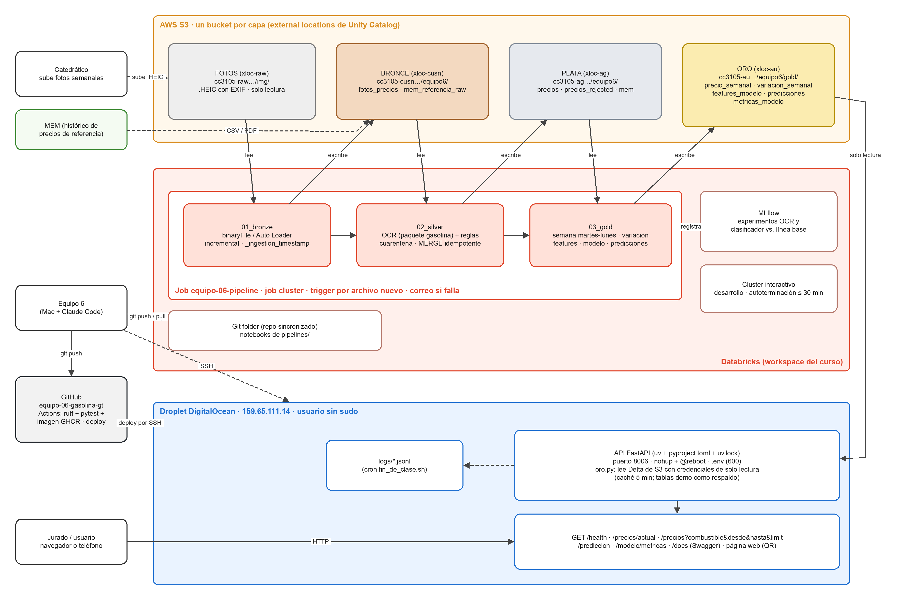

# Predicción del precio de la gasolina en Guatemala — Equipo 6

Proyecto final de ML Engineering (CC3105). Un pipeline de punta a punta que convierte **fotos de
bombas de gasolina** en datos, los organiza con la **arquitectura medallón** (Bronce → Plata → Oro)
en **AWS S3 + Databricks**, entrena un modelo que predice si el precio de **super, regular y diésel
sube, baja o se mantiene la semana siguiente**, y publica precios y predicciones en una **API REST**
en un Droplet de DigitalOcean.

- API: `http://159.65.111.14:8006` · Swagger: `/docs` (puerto 80XX del equipo; confirmar)
- Enunciado: [`docs/enunciado_cc3105_proyecto_final.pdf`](docs/enunciado_cc3105_proyecto_final.pdf)
- Instructivo del equipo: [`docs/instructivos/INSTRUCTIVO_GENERAL.md`](docs/instructivos/INSTRUCTIVO_GENERAL.md)
- Diagrama: [`docs/arquitectura.png`](docs/arquitectura.png) · Informe: [`docs/informe.pdf`](docs/) · Presentación: [`presentacion/`](presentacion/)

## Arquitectura



Editable en [app.diagrams.net](https://app.diagrams.net) con `docs/arquitectura.drawio`; se regenera con `python scripts/generar_arquitectura.py`. Resumen en texto:

```
s3://cc3105-raw-…/img/  ──►  BRONCE  s3://cc3105-cusn-…/equipo6/   bronze.fotos_precios (Auto Loader, incremental)
 (fotos del catedrático)       │
                               ▼  OCR + 5 reglas de calidad + MERGE
                             PLATA   s3://cc3105-ag-…/equipo6/     silver.precios, silver.precios_rejected
                               │
                               ▼  semana martes-lunes, variación, features, modelo (MLflow)
                             ORO     s3://cc3105-au-…/equipo6/     gold.precio_semanal, variacion_semanal,
                               │                                   features_modelo, predicciones, metricas_modelo
                               ▼  deltalake (credenciales de solo lectura)
                             API FastAPI en el Droplet (uv) ◄── usuario (HTTP) · equipo (SSH) · GitHub Actions (CD)
```

Databricks: Job `equipo6-pipeline` con 3 tareas encadenadas (Bronce → Plata → Oro) en un job
cluster, con trigger por llegada de archivos y alerta por correo. El desarrollo se hace en un
cluster interactivo con autoterminación.

## Estructura

| Carpeta | Contenido |
| --- | --- |
| `pipelines/` | Notebooks `00_setup.sql`, `01_bronze.py`, `02_silver.py`, `03_gold.py` y `job.json` |
| `src/gasolina/` | Paquete compartido por los notebooks y la API: extracción (OCR), reglas, features, modelo, lectura de Oro, API |
| `api/` | Punto de entrada de la API, `.env.example` y documentación del entorno |
| `config/config.yaml` | Valores que cambian (equipo, rutas S3, esquemas, umbral, puerto) |
| `tests/` | `pytest` (API y contratos) y `consultas_api.sh` (prueba de usuario final) |
| `scripts/` | `deploy.sh`, `fin_de_clase.sh`, `servidor_check.sh`, `generar_oro_demo.py` |
| `docker/` | Imagen de la API (la construye el CI y se publica en GHCR) |
| `docs/`, `presentacion/` | Diagrama, informe, enunciado, instructivos, diapositivas y resumen para el jurado |

## Reproducir el pipeline (Databricks)

1. Workspace → Create → Git folder con este repo.
2. Correr `pipelines/00_setup.sql` una vez (esquemas y tablas externas).
3. Correr `01_bronze` → `02_silver` → `03_gold` en el cluster interactivo, o el Job
   `equipo6-pipeline` con **Run now**. Los parámetros están en `config/config.yaml`.

## Desplegar la API (Droplet)

```bash
ssh <usuario>@159.65.111.14
git clone https://github.com/ArielaMishaanCohen/equipo-06-gasolina-gt.git ~/apps/gasolina-mlops
cd ~/apps/gasolina-mlops
cp .env.example .env && nano .env && chmod 600 .env   # credenciales de SOLO LECTURA
bash scripts/deploy.sh
```

`deploy.sh` instala las dependencias exactas de `uv.lock`, arranca la API con `nohup` (sigue viva al
cerrar SSH), agrega `@reboot` al crontab y espera a que `/health` responda. También se puede correr
desde GitHub: Actions → `deploy` → Run workflow.

**Por qué uv y no Docker en el Droplet:** Docker necesita instalar paquetes del sistema con sudo, y
el enunciado prohíbe instalar paquetes a nivel de sistema. uv vive en el usuario y garantiza las
mismas versiones con `uv.lock`. La imagen Docker existe igual: el CI la construye y la publica en
GHCR para correr la API en cualquier máquina con Docker.

## Desarrollo local

```bash
uv sync --extra api --extra dev      # o: python3.11 -m venv .venv && pip install -e ".[api,dev]"
uv run pytest
uv run gasolina-api                  # http://localhost:8006
BASE_URL=http://localhost:8006 bash tests/consultas_api.sh
```

Sin credenciales, la API usa las tablas Oro de ejemplo de `artifacts_demo/oro/` y `/health` lo dice
(`"fuente_oro": "demo"`). En una Mac, si aparece `No module named 'gasolina'`, corre
`chflags -R nohidden .venv`.

## CI/CD

- `ci.yml` (push y PR a `main`): ruff, pytest (pruebas automatizadas de la API) y, en `main`, imagen
  `ghcr.io/arielamishaancohen/gasolina-mlops` para `linux/amd64`.
- `deploy.yml` (manual): SSH al Droplet y `scripts/deploy.sh`.

## Equipo

| Rol | Integrante |
| --- | --- |
| Producción y coordinación | Ariela Mishaan |
| Datos | ________ |
| Modelos | ________ |
