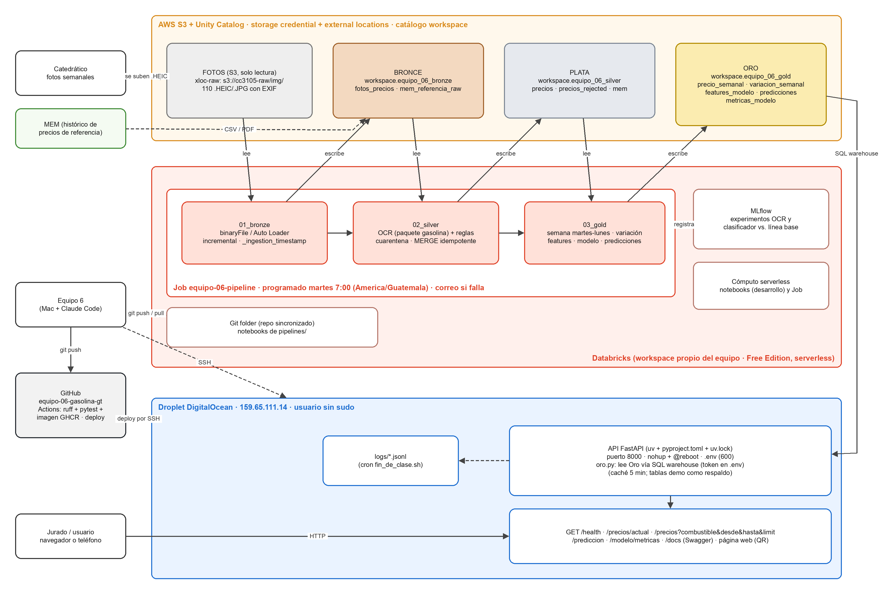

# Precios de combustible en Guatemala

Proyecto final de ML Engineering, CC3105. Equipo 06. 15 de noviembre de 2026.

Alina Carias, Marcos Diaz, Daniel Machic, Ignacio Mendez, Ariela Mishaan y Diego Soto.

## 1. Problema y arquitectura

El proyecto convierte fotografías de precios de combustible en registros estructurados y estima si el precio de súper, regular y diésel subirá, bajará o se mantendrá la semana siguiente. El objetivo es ofrecer un histórico consultable y una predicción reproducible mediante una API.

La arquitectura medallón conserva las fotos y sus metadatos en Bronce, aplica OCR y reglas de calidad en Plata y construye indicadores y modelos en Oro. Los precios se expresan en quetzales por galón. Las semanas comienzan el martes y terminan el lunes. El histórico del MEM aporta las observaciones necesarias para entrenar el clasificador.

Bronce lee las 110 fotos oficiales (2023 a 2026) directamente de `s3://cc3105-raw-…/img/` mediante la external location `xloc-raw` de Unity Catalog y su storage credential. Las tablas viven en los esquemas `workspace.equipo_06_bronze`, `equipo_06_silver` y `equipo_06_gold`. Cada notebook acepta una ruta `s3://` por capa para crear sus tablas como externas en el bucket de su capa; al 16 de noviembre `xloc-cusn`, `xloc-ag` y `xloc-au` siguen marcadas como solo lectura, por lo que las tablas son Delta gestionadas. La API consulta Oro mediante un SQL warehouse de Databricks y admite la lectura directa desde S3 cuando exista esa escritura.

<!-- pagebreak -->

## 2. Extracción y calidad de los datos

El paquete gasolina abre JPG, PNG y HEIC, aplica la orientación y lee fecha y GPS del EXIF. Si falta la fecha, utiliza la carpeta de origen. RapidOCR reconoce texto y números. Las reglas normalizan importes y asocian cada precio con una etiqueta de combustible cercana. En bombas, los recortes de las pantallas y la relación entre total de la venta y galones permiten revisar algunas lecturas. V-Power queda fuera del catálogo solicitado.

La evaluación utiliza las etiquetas existentes del equipo para 36 fotos y 85 precios legibles. Un precio es correcto cuando la diferencia absoluta es menor que Q0.005. Los precios de fotos ausentes cuentan como no encontrados. Las lecturas sin referencia manual se reportan por separado.

| Preprocesamiento | Correctos | Exactitud | Fotos completas |
| --- | --- | --- | --- |
| Gris con CLAHE | 78/85 | 91.8% | 80.6% |
| Gris con CLAHE ampliado al doble | 77/85 | 90.6% | 77.8% |
| Imagen original | 75/85 | 88.2% | 72.2% |
| Binarización | 44/85 | 51.8% | 30.6% |

La configuración elegida es RapidOCR con gris_clahe. Presentó seis valores incorrectos y un precio no encontrado. Se observaron diez lecturas adicionales sin etiqueta y cero salidas duplicadas para llaves etiquetadas. Los resultados por foto y las corridas se conservaron en MLflow.

Plata contiene 221 filas aceptadas de 2023 a 2026 y 26 rechazos: 14 fotos sin precios legibles, 6 por consistencia entre gasolinas, 5 por confianza inferior al umbral y 1 fuera de rango. La proporción de filas rechazadas es 26/247, equivalente a 10.5%. Las fotos de 2026 producen los mismos 93 registros que en la primera carga. Las reglas verifican rango de Q20 a Q60, combustible válido, fecha no futura, confianza mínima y consistencia de gasolinas. La carga utiliza MERGE con fecha, ubicación, combustible y modalidad como llave.

| Foto | Referencia manual | Resultado incorrecto |
| --- | --- | --- |
| IMG_7575.HEIC | Diésel Q24.89 | Sin detección |
| IMG_8064.HEIC | Regular Q35.16 | Q35.76 |
| IMG_8636.HEIC | Diésel Q41.69 | Q47.69 |

<!-- pagebreak -->

## 3. Variables y evaluación del modelo

El objetivo direccion_siguiente tiene tres clases. La dirección es sube cuando la variación semanal supera Q0.10, baja cuando es menor que -Q0.10 y se_mantiene para los demás cambios. Se comparan una regresión logística y un árbol de decisión globales con una línea base que repite la dirección actual.

Las variables incluyen las últimas cuatro variaciones, el promedio móvil de cuatro semanas, la diferencia entre súper y diésel y la dirección actual. El combustible se representa con one-hot. La variación del WTI y el subsidio activo se incorporan cuando hay datos. Los faltantes numéricos se imputan con la mediana del entrenamiento y se agregan indicadores de ausencia. Las semanas faltantes permanecen sin interpolar.

El histórico de variables contiene 264 filas entre el 26 de noviembre de 2024 y el 3 de noviembre de 2026. Se usaron 183 registros para entrenar y 30 para probar. La prueba corresponde a las últimas diez semanas con objetivo y dirección actual conocidos. Las filas de una misma semana permanecen en el mismo conjunto.

| Modelo | Accuracy | F1 macro | Selección |
| --- | --- | --- | --- |
| Línea base | 0.5000 | 0.2564 | Referencia |
| Regresión logística | 0.6000 | 0.3130 | Elegida |
| Árbol de decisión | 0.4333 | 0.3056 | Supera a la base en F1 |

La prueba contiene 18 subidas, ocho bajadas y cuatro casos de estabilidad. La regresión logística acierta 18 de los 30 registros, frente a 15 de la base. Su F1 macro sigue siendo bajo y no acertó casos de se_mantiene. La diferencia entre métricas muestra la importancia de revisar cada clase.

Los modelos se comparan y se eligen con la misma prueba temporal, lo que introduce sesgo de selección. Evaluar semanas futuras permitiría estimar mejor la generalización. El elegido se reentrena con todas las observaciones disponibles y se guarda como artefacto de MLflow. Las matrices de confusión, parámetros y métricas quedan en las corridas.

<!-- pagebreak -->

## 4. Operación y reproducibilidad

El Job equipo-06-pipeline encadena Bronce, Plata y Oro. Recibe catálogo, esquemas, rutas, modalidad del MEM, motor OCR y umbral de dirección como parámetros. La programación es semanal, los martes a las 07:00 de Guatemala. Las alertas de fallo se dirigen a sot22737@uvg.edu.gt y mis22052@uvg.edu.gt.

La validación incremental utiliza esquemas separados del equipo y dos fotos reales. Primero se procesa la foto del 7 de enero de 2026 y después se agrega la del 13 de enero de 2026. Las fuentes complementarias se copian desde los archivos existentes. La prueba permite verificar dependencias y conteos conservando las fotos de producción.

{{EVIDENCIA_JOB}}

El workspace consultado no lista clusters clásicos. Las ejecuciones utilizan cómputo serverless de Jobs. Los nodos y workers los administra la plataforma. En un cluster clásico interactivo, el equipo controla el tiempo ocioso y la autoterminación. El cómputo de Jobs se dedica a la ejecución programada. Los registros consultados no permiten calcular un costo monetario real.

La variante OCR ampliada superó el límite de 1 GB por función Python de serverless. El notebook de experimentos procesa ahora una foto a la vez en el driver. Las corridas terminadas se reutilizan tras comprobar sus etiquetas y versión. Las latencias de driver y workers son orientativas y se excluyen del desempate cuando se mezclan ambos entornos.

La validación local obtuvo 143 pruebas aprobadas y una omitida por ausencia de PySpark. Ruff y la compilación de Python aprobaron. Oro y la comparación OCR terminaron correctamente con Spark y MLflow en Databricks. El paquete se instala como wheel. Los notebooks mantienen rangos de dependencias compatibles con el entorno seleccionado.

<!-- pagebreak -->

## 5. API, alcance y lecciones

FastAPI implementa health, precios actuales, histórico con filtros y paginación, predicción por combustible y métricas del modelo. La documentación está disponible en /docs. El servidor utiliza uv con pyproject.toml y uv.lock. El despliegue conserva el proceso al cerrar SSH y lo reinicia mediante cron. Las credenciales se configuran en un archivo privado .env.

Se probaron siete casos de consulta de la API desde este entorno contra las tablas reales. Todos respondieron HTTP 200 y health confirmó fuente_oro=databricks. La API está publicada en el Droplet del curso, en http://159.65.111.14:8000, y su documentación interactiva en /docs. Desde una red externa, health responde fuente_oro=databricks con las cinco tablas de Oro. El proceso se despliega con scripts/deploy.sh en modo venv, sigue activo al cerrar SSH y se reinicia con @reboot en cron.

| Combustible | Semana objetivo | Predicción | Probabilidad |
| --- | --- | --- | --- |
| Súper | 2026-11-10 | baja | 0.8139 |
| Regular | 2026-11-10 | baja | 0.8613 |
| Diésel | 2026-11-10 | baja | 0.8908 |

La última semana del histórico comienza el 3 de noviembre, por lo que la predicción disponible corresponde al 10. El equipo indicó que no contará con datos de esa semana para generar la predicción del 17. La fecha objetivo se conserva según los datos disponibles.

La lectura de fotos usa la external location del bucket crudo. Para escribir tablas externas hace falta que las external locations de cada capa permitan escritura y `CREATE EXTERNAL TABLE`; el código ya recibe esas rutas como parámetros del Job. Mientras tanto, las tablas gestionadas permiten trabajar con la infraestructura disponible, como aprobó el catedrático el 13 de noviembre, y la API lee Oro mediante el SQL warehouse.

Las principales lecciones fueron conservar las fotos y su trazabilidad, medir la extracción con etiquetas, separar temporalmente entrenamiento y prueba y revisar F1 además de accuracy. También se comprobó que aumentar la resolución puede elevar el consumo de memoria sin mejorar la exactitud.

Las evidencias y corridas se detallan en docs/modelos/CIERRE_MODELOS.md y docs/evidencias_job.md. Los notebooks, pruebas y código de la API forman parte del repositorio del equipo.
